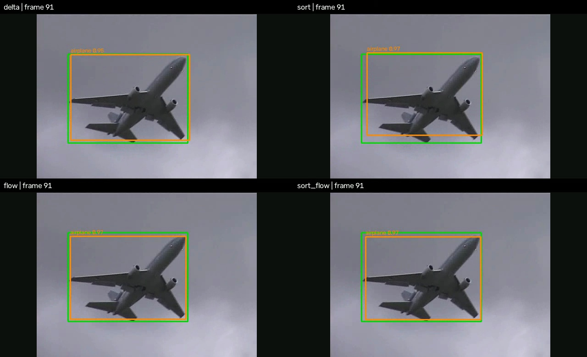
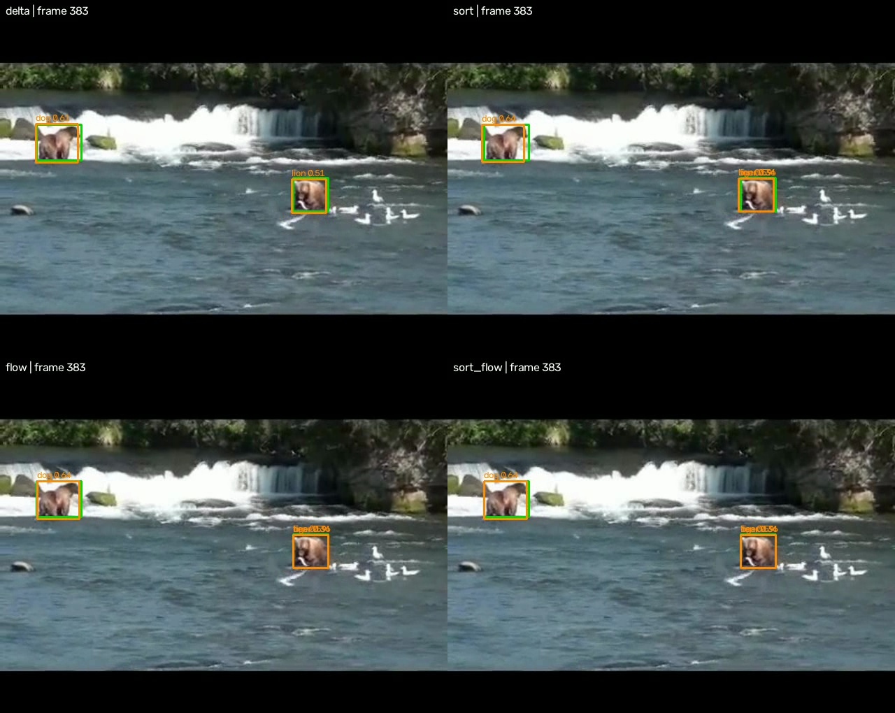
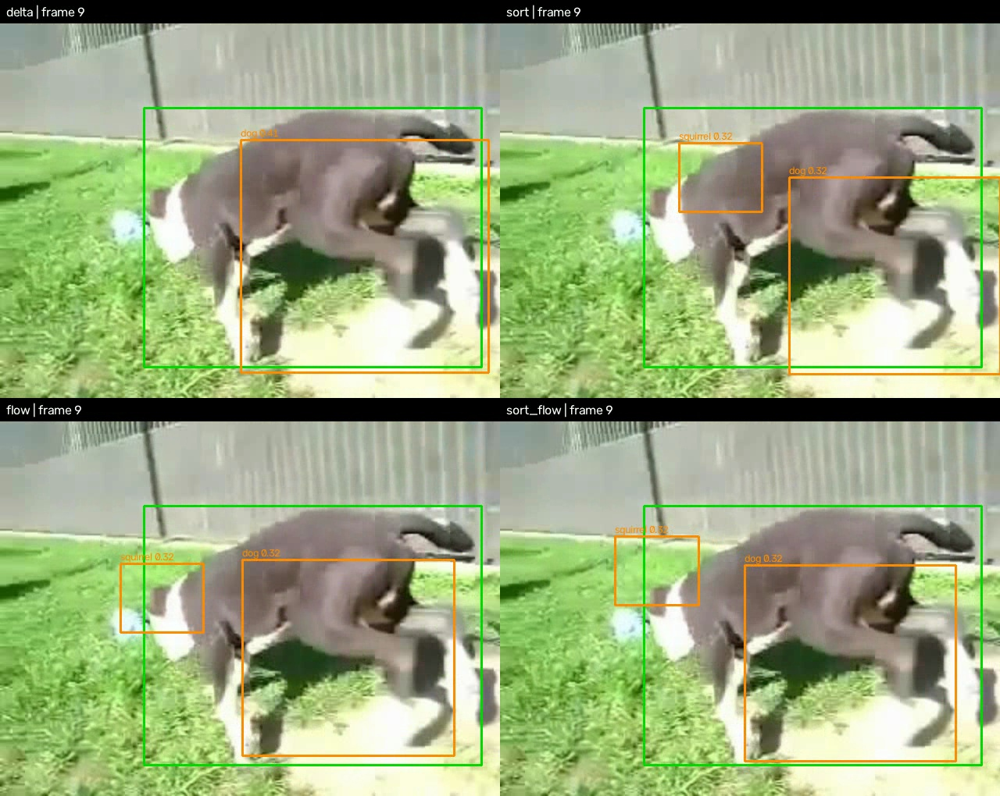

# Selected ImageNet VID tracking comparison

## Measured results

These are single-run measurements on **2,772 selected frames from 30 ImageNet VID
videos**, split into **279 clips** of up to 10 frames. They are not full ImageNet
VID validation results or reproductions of the paper's reported benchmark.
Every method uses the same EfficientDet-D0 checkpoint, with one teacher keyframe
per clip. SORT prediction-only starts with zero velocity and holds boxes stationary.

### CPU: one configured thread, score threshold 0.1

All four methods run on CPU. Source: [`reported_results.json`](reported_results.json), `cpu` entry.


| Method | mAP50 (%) | AP50:95 (%) | FPS | ms/frame | Neural conv. GFLOPs/frame |
| --- | ---: | ---: | ---: | ---: | ---: |
| Delta Distillation (teacher + student) | 70.33 | 47.28 | 2.91 | 343.74 | 1.269 |
| Teacher + SORT prediction only | 65.82 | 40.38 | 43.87 | 22.79 | 0.464 |
| Teacher + KLT | 70.45 | 48.12 | 28.62 | 34.94 | 0.464 |
| Teacher + SORT + KLT | 70.23 | 47.02 | 28.01 | 35.70 | 0.464 |


### Interpretation and measurement scope

- The CPU KLT baseline achieved 70.45% mAP50 at 28.62 FPS, versus 70.33% at
  2.91 FPS for this Delta Distillation implementation. This is an observed
  subset result, not evidence of general superiority or statistical significance.
- FPS includes the teacher cost plus student/tracking computation, normalization,
  transfers and detector postprocessing. Warmup, image loading/resizing, JSON
  writing and metric evaluation are excluded. Delta processes batched clips;
  tracking advances sequentially. These are throughput measurements, not
  streaming latency measurements.
- GFLOPs count neural convolutions only (2 FLOPs per multiply-accumulate plus
  bias additions), excluding KLT, Kalman, activations and NMS. They are not total
  pipeline costs and do not use the paper's multiply-add counting convention.
- The saved CPU summary does not record the processor model or server software
  versions. These details and repeated timing runs are still needed for a
  reproducible performance report. The local dependency versions below are
  not a record of the server environment used for this table.

## Qualitative examples

Snapshots from the saved CPU evaluation, showing the tenth frame of the first
clip in selected videos 39, 93 and 332. Panels show Delta Distillation / SORT
on top and KLT / SORT + KLT below. **Green:** ground truth. **Orange:** predictions.
These examples include classification and localization errors; use the table
above to compare performance across the complete selection.

**Airplane — video 39, frame 91.**



**Bears — video 93, frame 383.** This scene illustrates incorrect class predictions.



**Dog — video 332, frame 9.** A challenging close-up with localization errors.



## Running and visualizing


Visualize a completed evaluation without rerunning the model:

```bash
python /path/to/baseline/visualize.py \
  --results /path/to/results \
  --selection /path/to/selection.json \
  --frames /path/to/ILSVRC2015/Data/VID
```

Videos appear in `results/visuals`: delta/SORT on top, flow/SORT+flow below.
Green boxes are ground truth; orange boxes are predictions with class and score.
Only evaluated frames are rendered. A separate video starts at each video change
or frame gap. `--score 0.3` controls display only, and `--fps 10` sets playback
speed (not inference speed). This script requires only NumPy and OpenCV.

Run a test (replace the paths with your server's paths):

```bash
python /path/to/evaluate_tracking.py \
  --deltadistill-path /path/to/delta-distillation-main \
  --frames /path/to/ILSVRC2015/Data/VID \
  --selection /path/to/selection.json \
  --output /path/to/results \
  --device cpu \
  --threads 1 \
  --score-threshold 0.1 \
  --max-clips 1
```

Keep `tracking.py` beside `evaluate_tracking.py`. The checkpoint defaults to
`checkpoints/test/efficientdet_d0.pth` inside `--deltadistill-path`; use `--checkpoint`
if it lives elsewhere. No manual `PYTHONPATH` setting is needed for the checkout.

The default is the bundled [`selection.json`](selection.json), resolved relative
to the script. It contains relative VID frame paths and ground truth, not images.
Dataset: [ImageNet VID on Hugging Face](https://huggingface.co/datasets/guanxiongsun/imagenetvid/tree/main).
Supply the extracted ImageNet VID JPEGs with `--frames`; use `--selection` for a different manifest.
Only its 2,772 frames from 30 ImageNet VID videos are evaluated. Ground truth
comes from this manifest, and original JPEGs come from the local ImageNet VID
folder. No full-validation annotation file is loaded.
`pycocotools` is retained solely as the evaluation API, preserving the AP metric.

Remove `--max-clips 1` to evaluate the entire selection. Use `--selection` and `--frames` to override
paths. Dependencies: the project's EfficientDet environment, `opencv-python`,
`pycocotools`, and `omegaconf`. The code was tested with PyTorch 2.3.1 and timm 1.0.22.

| Method | Frames after the keyframe |
| --- | --- |
| `delta` | Original delta student |
| `sort` | SORT seven-state Kalman prediction |
| `flow` | Sparse Lucas–Kanade with filtered median displacement |
| `sort_flow` | Kalman prediction corrected with flow-based centers |

Every clip starts with the same checkpoint's teacher and uses at most nine
tracking/student frames. Tracks reset at each clip, video boundary or frame gap.
One observation cannot establish velocity: SORT-only holds boxes stationary.
No association, new-track creation or early detector refresh occurs between
keyframes. Classes, scores and sizes are retained. Flow failure holds the last
box in `flow`, and uses Kalman prediction in `sort_flow`.

All methods share preprocessing, NMS, score threshold (0.1), selected frames,
and ground truth. All trackers copy the first-frame teacher detections from the
delta run, ensuring identical keyframe inputs despite batch-size numerical differences
and NMS ordering differences. A separate single-frame teacher call measures
the teacher cost charged to each tracker; its detections are not used. Short clips
are padded for delta inference only; padded outputs are never scored. Frames
with zero predictions are still scored. Compare the four newly computed results,
rather than mixing metrics from earlier runs.

Results are written to `--output` (default: `exp/tracking_baselines` inside the
Delta Distillation checkout), as `summary.json` and per-method prediction JSON files:

- `mAP50`: mean AP at IoU 0.50, as a fraction (multiply by 100 for percent).
- `AP`: mean AP over IoU 0.50–0.95.
- `FPS`: real evaluated frames / measured seconds; includes tracking.
- `ms_per_frame`: the reciprocal timing measure.
- `neural_conv_GFLOPs_per_frame`: executed convolution arithmetic, amortized
  across real frames, using 2 FLOPs per multiply-accumulate plus bias additions.
  The three trackers pay one teacher call per clip. Delta pays for the teacher
  and its students, including padded computation on short clips.

**GFLOPs are not total pipeline FLOPs.** Optical flow, NumPy Kalman operations,
activations and NMS are excluded. Identical neural GFLOPs for the three tracking
methods do not mean identical total computation; use measured FPS to compare
actual runtime. These counts also use a different convention/scope from the
paper's multiply-add counts.

Timing excludes one warmup, disk decoding/resizing, JSON and evaluation. It
includes normalization, device transfers, detector postprocessing and tracking.
Delta uses clip batching, so FPS describes this implementation's throughput,
not online latency. The shared teacher timing is charged to every tracker.


## Attribution and implementation choices

This experimental extension was implemented with AI assistance. The contributor
is responsible for validating the implementation, measurements, and conclusions.
It builds on [Delta Distillation](https://github.com/Qualcomm-AI-research/delta-distillation)
by Habibian et al. (ECCV 2022); the upstream [license](../LICENSE) and copyright
notices remain unchanged.

The Kalman state and initialization follow the model used in
[SORT](https://github.com/abewley/sort) by Bewley et al. (2016). This extension
implements only prediction between keyframes, not SORT's detection association.
Point selection and sparse pyramidal Lucas–Kanade tracking use OpenCV.
Forward–backward consistency and median displacement draw on
[Kalal et al., Forward-Backward Error (2010)](https://cmp.felk.cvut.cz/ftp/articles/matas/kalal-2010-fb_track-icpr.pdf).
Our filtering thresholds and measurement covariance `R = (4 / quality**2) * I`
are engineering heuristics, not formulas validated by those papers. Quality is
the fraction of initially selected points surviving the filters.
